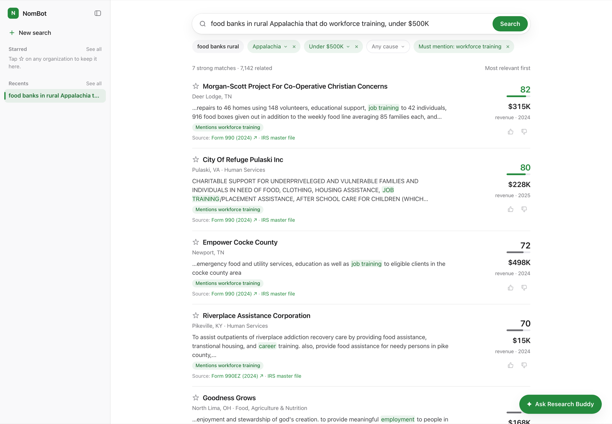
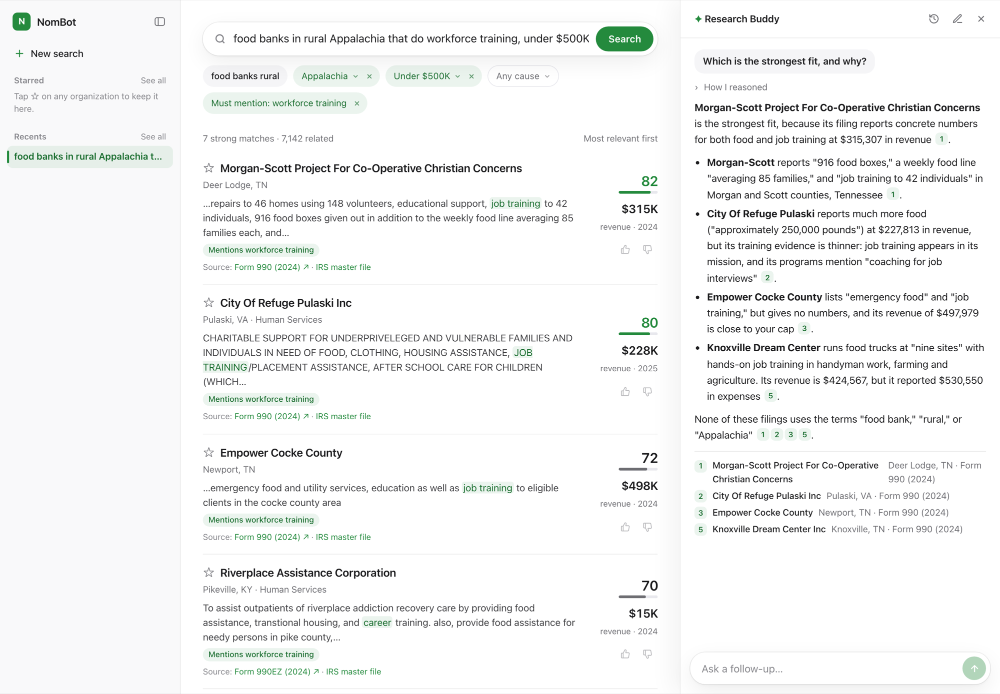

# NomBot

**Plain-language search over every US nonprofit, built on public IRS data.**
Institute on Generosity AI Fellowship · **Deadline: Dec 31, 2026** · Sister project: [GrantRadar](https://github.com/institute-on-generosity/NomBot-GrantRadar/tree/GrantRadar)

## Problem
IRS data on ~1.8M nonprofits is public but buried in raw files. Paid tools don't support plain-language search.

## Solution

| Phase | What | Planned | Status |
|---|---|---|---|
| **1. Search** | Question → ranked nonprofits (EIN, location, financials, cause). Also a JSON API. | Nov 15 | ✅ **Built Oct 7** (local) |
| **2. Research Buddy (RAG)** | Chat with the results. The LLM reasons over the filings, shows its steps, cites every claim. | Nov 22 | ✅ **Built Oct 7** (local) |

**Search finds organizations. Research Buddy reasons about them.**

### Built beyond the plan
| Area | Feature |
|---|---|
| **Ranking** | **Relevance score** 0–100 per result, with Claude's one-line reason under **Why this result** (hover or focus) · strong matches first, weaker ones folded under "Show N weaker matches" |
| **Filters** | **Editable chips** read from the question: state, city, **Appalachia region**, budget (under $X, or **$1M / $10M or more**: established orgs for a small gift), cause, **graded cause label** (climate, women and girls: main focus by default, option to include partial focus; Oct 17), "must mention" · results update in ~0.4s |
| **Search** | **Suggestions** under the search box · **exact-mention** badges · **Google-style rows** (Oct 16): the name as the one strong element (link color, normal weight), one grey line of facts (place · cause · income with year · **finance status**: Growing/Shrinking, Surplus/Deficit as plain text after a small colored dot, amber not red, from the newest e-filed 990 when there is one; hover for the figures), a **two-line mission snippet**; Save, Compare, Why this result and IRS sources show on hover or focus · include tiny/inactive orgs · **CSV export** · **Print summary** |
| **Org detail** | **Cause labels** (climate, women and girls) with tier and a short why · **Website** (from the 990 header) · **Staff and volunteers** (990 Part I), All-volunteer badge · **years tax-exempt** (track record, from the IRS ruling date) · **where the money comes from** (Part VIII, government grants split out) · **this year vs last year** (Part I) · cash on hand, spending split (programs / admin / fundraising), liabilities · **leadership and governance**: paid leaders, board independence, audit and policy checklist (Parts IV, VI, VII) · IRS status · **financial health rating** (Strong / Medium / Weak) from fixed, visible rules, in plain words (Income, Bottom line, Debts, Donations), with **questions to ask** · **Grants received** (Oct 17): from foundations (990-PF), from public charities (Schedule I, split by DAF sponsor, community foundation, United Way, other) and **federal awards** (USAspending, by fiscal year, agency, program and place of performance), as three totals, one table by year, top funders and programs with Show more, each with a source note (Schedule I installments, federal fiscal year vs tax year, overlap between sources) · **Grants given**: Schedule I by tax year next to the return's own Part IX total, 990-PF, top recipients · **Print** as a 2-page memo |
| **Sources** | **IRS master file** and **SOI financial** viewers: every number links to its exact row · open beside the org in a popover · one side panel with a **tab per source** that pushes the page aside (doesn't cover it), closed in one step |
| **Analysis panel** | Results on the left (~60%); a sticky **knowledge panel** on the right (~40%): quiet text tabs with an underline, a **⋯** menu (Export slide), soft grey section cards (Oct 16). **Overview**, diagram first like Google's image strip: the headline with **one chart** picked for the result set (deficits, growing vs shrinking, or income sizes), then **Key facts** (label → value rows: related orgs, median income, share that spent more than they took in, foundation dollars + top funder), both computed from the data so they show before the AI text, then the **AI overview** card (2 cited bullets, the rest under Show more); **Track record** as one row (median years tax-exempt; open it for one bar per age bracket, click one to list its orgs with the year each became tax-exempt); **People also search for** (3 related searches, each runs on click); **Breakdown** (size, places, causes, team, **track record**: years tax-exempt; click a bar to list its organizations), **Map** (counties, Appalachia shaded; click a county to list its orgs; switch to **Gaps**: high-poverty counties (the poorest quarter of the map's counties, up to 20%; Census) with none of these orgs, listed beside the map; hovering a county on the map or in the list highlights it in both, hover its rate for a plain-language explanation), **Themes** (kinds of work, by Claude, each with its **foundation grants** in the newest three tax years: **median $ per org** (orgs with none count as $0), total, how many funded, the **least funded** flagged; on state searches, the share from that state's foundations), **Funders** (foundations that fund these orgs, from 990-PF grants; click one for the orgs here it paid and its profile; plus strong matches no foundation funds yet), **Finances** (growing, shrinking, deficit, low cash, mostly gifts; pick one to list the orgs) |
| **Research answers** | Aggregate questions ("how much government money goes to climate", "which states get the least per resident", "how many animal shelters in Ohio run deficits") get a page planned for the question: **research** questions open in the Research section (**`/research/ask?q=`**, sidebar Research highlighted, back link to the home page's Research prompts) as a **ChatGPT-style conversation**: one centered column, each question a right-aligned bubble, each answer plain content (bold answer sentence, key numbers inline, the chart, short bullets, a quiet icon row: copy, CSV, Export slide, How we got this), the composer pinned at the bottom with a one-line disclaimer, **New question** for an empty chat. Each **follow-up** ("and for women and girls?", "by state?", or one of up to 3 suggested chips under the latest answer: answerable next questions kept on the research question by rule, no cause nobody asked about, no wider place, nothing already asked, then ranked by a fast Claude call that can only pick from that list, streamed in after the answer) becomes a new answer, "why" questions stream a short AI interpretation from the numbers on the page (marked as such), a typing indicator shows while it works, and the whole thread lives in the URL (`&f=…`). Research Buddy is hidden there (the composer is the chat) and show only the **answer card** (headline, up to 3 tiles, one short chart with the comparison drawn in, up to 2 bullets that add something new), with no org search, landscape or AI overview run at all; **mixed** questions about a specific org set ("how many animal shelters in Ohio run deficits") show the card, then those organizations as the evidence; plain org searches and people keep their pages. The card also has what our data can't answer and where to look (e.g. USAspending), **How we got this** (cause set, method, specific caveats, coverage, every SQL query, sources), CSV and **Export slide**. 15 question types: total, share, X vs Y, trend, fastest-growing causes, by state (per resident), rural vs urban, top funders/recipients, out-of-state funders, grant size, general operating support, concentration, foundations funding both X and Y, org counts (deficits, under 3 months of cash, government-reliant). Sources: foundation grants, or government grants / contributions / revenue as reported on Form 990. Research Buddy uses the same engine as a tool for follow-ups ("and for women and girls?", "by state?"). Also answers **the largest 1% of nonprofits**: their share of all revenue (or contributions, government grants), and the share of foundation or DAF money they get. School districts and public colleges are kept apart from private colleges. Form 990 and federal totals for a graded cause count only orgs whose main purpose it is. **Never mislead** (Oct 17): any part of a question the engine can't apply (years outside the data, a place, a top-N set, a multi-year condition, per resident) becomes a visible "not included" note and the answer is marked partial; years outside the data are named in the headline ("Our data starts in 2022, so 2015–2021 isn't included"). Also **Appalachia** (ARC counties) as a place, **the N largest foundations' share**, conditions **N years in a row** ("deficits two years in a row"), and **household giving** (IRS SOI itemized charitable deductions by state, county, income and year, 2013–2023, after inflation) |
| **Research** | A feed of verified findings (`/research` and the sidebar; was "Insights". The home page **Research** tab is a prompt set like the others: example research questions that open their answer on `/research/ask`): funding gaps, rising and fading, money flows, track record, affiliations, financial stress. Each card: a short headline, **2–3 key points** (bold numbers, last one "Why it matters"; the one-line summary until a row has them), **Vega-Lite chart**, **Method** (method, caveats, the SQL), sources, date · one **Open research** button (or the headline) → the finding's page · **CSV**, **PNG/SVG** chart export, **Save** to a per-browser **Report** exported as one Markdown file with citations |
| **Research finding page** | `/research/<slug>`: **key numbers** (2–4 stat tiles), large chart (PNG/SVG), what it means (the key points), **data table** (every row, sortable, formatted, CSV), **organizations involved** (open in the org popover, **Search similar**), **Ask about this finding** (right-side panel like Research Buddy, opened from a floating button; answers from this finding's data only, general knowledge marked), method, caveats, SQL, sources, **Cite** (copies a citation), **related research**, Save |
| **Compare** | Pick 2–4 results (button in each row's right column) → side-by-side finances, staff, volunteers, mission |
| **Research Buddy** | Docked chat panel · **reasoning steps** shown · citations open the org · **chat history** per search |
| **Personal** | **History** and **starred (★)** organizations, sorted into **folders**, in a Claude-style sidebar |
| **Quality** | 👍/👎 votes (stored; hidden from rows for now) · **search eval** (50 questions, 91%) · **search benchmark** (`npm run bench`: keyword vs meaning vs hybrid vs OpenSearch BM25, before Claude scoring) · **Buddy eval** (30 questions, 1 unsupported claim of 401) |
| **Design** | Apple-style UI, **dark mode**, centered loading card with steps |
| **Partner API + MCP** | **API keys** (`npm run api-key`, shown once, sha256 stored, per-key rate limit) · `GET /api/v1/search` (`label=climate|women_girls`, `label_tier=primary|all`), `/org/<ein>` (with `labels`), `/research`, `/research/<slug>`, `/research/questions`, `/answer` · **remote MCP server** at `/mcp` (5 read-only tools, incl. `answer_research_question`) for Claude, ChatGPT and other AI tools · public docs at **`/api/docs`** + `/api/openapi.json` · no LLM calls, except `/api/v1/answer?q=` (one small routing call, ~$0.006 per new question; `?spec=` and MCP skip it) |

## Users

| Who | Gets |
|---|---|
| **Developers** | Raw, structured data via the keyed read-only API and MCP server (`/api/docs`) |
| **IoG research team** (+ donors, program officers) | A research buddy: patterns, comparisons, recommendations |

## Experience
*Real screenshots of the local app, Oct 7, 2026 (5-state data).*

**Developer**
```http
GET /api/v1/search?q=food+bank+workforce+training&state=WV,KY&max_revenue=500000
Authorization: Bearer nb_live_…
```
→ JSON records: `ein`, `name`, `city`, `state`, `ntee`, `financials`, `mission`, `score`.

**Search:** *"food banks in rural Appalachia that do workforce training, under $500K"* → editable filter chips (Appalachia, under $500K, must mention workforce training) → strong matches ranked by relevance, each a name, one grey line of facts (place, cause, income, finance status) and a two-line mission snippet; Save, Compare, Why this result and IRS sources on hover. Beside them, the analysis panel zooms out (overview, finances, gaps map, themes, funders).

> Screenshot from Oct 7: rows have since been restyled after Google (name, one grey facts line, two-line snippet) and the analysis panel added as a knowledge panel.



**Research Buddy:** a follow-up about the results → "How I reasoned" (expandable) → a direct answer → bullets citing each filing [n] → the sources list.



## Architecture

<picture>
  <source media="(prefers-color-scheme: dark)" srcset="docs/architecture-dark.svg" />
  
</picture>

[Interactive diagram](docs/architecture.html) · Self-hosted on the MacBook (Oct 16); Supabase + Vercel remain the cloud target.

- **Search:** question → Claude parser → filters + search text → one SQL + vector query → Claude scores the top 40, 0–100 with a reason → strong matches first, weaker ones folded. The query draws a few thousand candidates from indexes (2,000 nearest by meaning on a half-precision HNSW index, up to 1,000 keyword hits per source, up to 300 filings that state a required activity), then joins only those. One cached search (200 rows, 10 min) serves the results, "Show more" and the landscape. The embedding model loads at server start; `warm_search()` keeps the indexes in memory (every 10 min).
- **Research Buddy:** follow-up question → top 15 ranked results' 990 text → Claude reasons (steps shown) → answer citing [n] for every claim. No source, no claim.
- **Landscape:** the 200 closest orgs (same filters and ranking) → counts by size, city, cause, team, age (IRS ruling date); counties via `zip_regions`; funders via `grants`; themes by Claude. **Funding by theme:** one indexed query sums each org's linked grants in the newest three tax years (~10 ms for 200 orgs), then each theme adds up its orgs.
- **AI overview:** landscape (200 closest) → tiles + one chart, no Claude (`lib/overviewFacts`). The 20 closest matches in search order (not waiting for relevance scores; Claude is told some may not fit and cites only those that do) + computed figures (sizes, places, causes, team sizes, the chart's takeaway) → Claude → one-line headline, 2–3 bullets [n] (citations point into its own list), related searches. Runs alongside relevance scoring.
- **Export slide:** in the browser only: headline, key numbers, chart (Vega, light, off screen) and bullets → one 16:9 slide → PNG (canvas, 1920×1080) or PPTX (pptxgenjs, editable text). Nothing sent to the server.
- **Research answers (Oct 16):** question → free regex screen (plain org searches skip the rest) → **router** (Claude Sonnet 5.5, low effort, structured output, prompt-cached, answers cached 24 h) → a spec: metric, cause (graded label, else NTEE prefixes, else a keyword set marked approximate), money source, years, place, condition → **answer engine** (`lib/answer.ts`): fixed, parameterized SQL blocks on three slim views (generosity-data migration 033: `grant_clean` 4.93M grants, `grant_totals`, `flag_year` 777K returns), never model-written SQL → headline, tiles, chart and bullets from templates over the results. **Content plan** (`contentPlan` in `lib/answerSpec.ts`): research → redirect to `/research/ask`, card only, saved to `research_questions` (generosity-data migration 035: question, spec, headline, times asked; no personal data) for the **Asked questions** list (recent, most asked) above the findings on `/research` and the home Research tab (the question parse, org search, relevance scoring, landscape and AI overview never run; ~2 s new question, ~0.5 s cached); mixed (`count_orgs` with a cause) → card at once, then the org list streams in under it; anything the router isn't sure about → the normal search page. Research Buddy calls the same engine as the `research_answer` tool; the API and MCP return the same JSON.
- **Research layer (Oct 16–17, generosity-data migrations 038–046):** pre-aggregated facts the answer engine reads first, plus grant-size histograms for medians (046) and the company foundation flag (045). `grant_cube` sums every clean grant by tax year × recipient state × rural × NTEE code × recipient kind × recipient revenue band × foundation asset band × foundation type × cause labels (948,897 rows instead of 4.93M grants); `grant_recipient_year` (exact distinct recipients, concentration) and `grant_county_year` (county rankings). A **cause taxonomy** maps plain-English causes to all 681 NTEE codes (`cause_lookup`). New: a **breakdown** metric (by cause, NTEE code, county, recipient size, foundation size or type, recipient kind, year; dollars, grant counts or average grant) and **filters** on any foundation-grant question (recipient revenue, foundation assets, family-named / operating / trust foundations, school districts and colleges). Same numbers as the `grant_clean` queries (51 checks, `eval/answer-cube.mts`). Place answers say grants are **counted where the recipient is headquartered** and flag **DC** as an outlier. **Grant-size histograms** (migration 046: amount buckets per cube cell for foundation, Schedule I and federal grants) answer medians and percentiles. Schedule I lines that name no recipient stay out of the charity views and sit in `charity_not_itemized` (migration 050), which national `charity_grants` totals show beside the total. Refreshed concurrently by `refresh_research_layer()` in `db/refresh.sql`. [Data dictionary](https://github.com/institute-on-generosity/generosity-data/blob/main/docs/research-layer.md)
- **Inflation and benchmarks (Oct 17, generosity-data 052–053):** trend answers deflate by BLS CPI-U (`cpi_u_year`: calendar-year average for tax years, October-September average for federal fiscal years, base = newest annual average, now 2025) and show growth after inflation next to nominal, with a **Current / 2025 dollars** radio under the chart (a Vega-Lite param) and real-dollar CSV columns. National all-cause 990-PF answers read `benchmark_coverage` (IRS SOI grants paid, Giving USA giving by foundations) into Coverage and Method; national Form 990 totals show SOI's 501(c)(3) figure as context.

- **Household giving and never-mislead guard (Oct 17, generosity-data 054):** IRS SOI individual income tax files (county 2013–2023, ZIP 2013–2022, `etl/load_soi_individual.py`) → `soi_individual_county` / `soi_individual_zip` → answer source `household_giving` (totals, trend with CPI-U, by state, county, income class, per return, share of AGI, itemizer share). Router: regions ride on `area` ("appalachia" → `spec.region`, a separate nullable field made the structured-output grammar too large), plus `topN` and `streak`. Engine: `honorGuard` checks every spec part against what the SQL applied (`Place.used`, `ctx.honored`) and turns the rest into missing notes; sentence-style router notes are their own headline.

> Diagram out of date: it doesn't show the BLS CPI-U and IRS SOI / Giving USA benchmark loads (generosity-data 052–053) or the IRS SOI individual returns (household giving, 054) feeding the answer engine.
- **Regions:** ZIP → county lookup (`zip_regions`) powers the Appalachia filter (ARC's 420 counties).
- **Finances:** one rule set (`orgHealth`) for row tags, the Finances tab and the AI overview: the newest e-filed 990 (this year vs its prior-year column, cash on hand), else SOI + master file.
- **FLAG diligence (org page):** the newest 990's `filing_flag` row → fixed rules in `lib/flag.ts` (income, bottom line, cash, debts, donations, board, insiders) → red / amber / green signals, plus a question to ask for each concern. One deficit year is amber; red only when it repeats. Shared with GrantRadar. No AI verdict.
- **Research (Insights) feed:** a separate job writes findings to `insights` (chart spec, data rows, SQL, sources); the app shows only `verified` rows, best score first (`/api/insights`). Charts render in the browser with vega-embed, loaded only when a chart scrolls into view. **Finding page:** one cached row (`use cache`, hours) → stats, chart, table; orgs and related findings stream in. **Ask about this finding:** question → that finding's headline, summary, key points, method, caveats, key numbers, data rows (CSV, up to 60K characters) and orgs → Claude (Sonnet 5.5) → answer from the data, general knowledge marked.
- **Partner API + MCP (Oct 16):** partner or AI tool → `Authorization: Bearer nb_live_…` → route handler checks `api_keys` (sha256, 10 s cache), scope and per-key rate (in memory, per process) → the same data functions (`lib/api.ts`) serve REST (`/api/v1/*`) and MCP tools (`/mcp`, Streamable HTTP, stateless JSON) → daily counts in `api_usage`. Read-only, **no Claude calls** (search uses the local embedding model). No direct database access for partners.
- **Gaps (Map):** `county_need` (Census poverty, 3,144 counties) vs. where the 200 closest orgs are based → high-poverty counties (the poorest quarter of the map's counties, capped at 20%) with none, limited to loaded states.
- **Hosting (Oct 16):** runs on the MacBook for now, not the cloud (Supabase Large would be ≈$129/month). Production builds start at login as launchd services (`~/iog-host/run-app.sh`, NomBot :4000, localhost only), reached through **Tailscale Funnel** (a fixed public `*.ts.net` link to :4000). GrantRadar is merging into NomBot, so its :4001 service and the earlier Cloudflare quick tunnels are off. `web/proxy.ts` asks for `SITE_PASSWORD` (HTTP Basic) on every page and API when set, so a public link can't run Claude searches on our key. `/api/v1/*` and `/mcp` skip it (they need an API key), and `/api/docs` is public. Nightly `pg_dump` to `~/Backups/nombot` (newest 3). A fixed address and staff email login need a domain on Cloudflare.

## Data

| Source | Gives | Link |
|---|---|---|
| IRS EO BMF | 1.8M orgs: name, EIN, address, NTEE | [irs.gov](https://www.irs.gov/charities-non-profits/exempt-organizations-business-master-file-extract-eo-bmf) |
| IRS SOI extract | Revenue, expenses, assets (~300K orgs) | [irs.gov](https://www.irs.gov/statistics/soi-tax-stats-annual-extract-of-tax-exempt-organization-financial-data) |
| Census SAIPE + population estimates | County poverty, income, population (3,144 counties) | [census.gov](https://www.census.gov/programs-surveys/saipe.html) |
| IRS 990 e-file XML | Mission + program text (embeddings); website (522,598 filings); FLAG diligence fields: prior year, balance sheet, functional expenses, board, policies, officers (907,095 filings, every state) | [irs.gov](https://www.irs.gov/charities-non-profits/form-990-series-downloads) |
| IRS 990-PF e-file XML | Who funds these orgs (Funders tab): every US foundation, 2023–2026 IRS years (139,749 foundations, 5.72M grants; shared with GrantRadar); recipients linked 66.0% (58.4% of $) | [irs.gov](https://www.irs.gov/charities-non-profits/form-990-series-downloads) |
| NCCS NTEE | Cause categories: all 681 codes, plus 287 plain-English cause terms mapped to them (research layer) | [nccs](https://urbaninstitute.github.io/nccs-legacy/ntee/ntee.html) |
| Research layer (derived, generosity-data 038–040) | Grant fact cube (995,187 rows), recipient-year (803,981) and county (139,214) rollups, revenue bands for 1,396,855 orgs, asset band and type for 139,749 foundations | [dictionary](https://github.com/institute-on-generosity/generosity-data/blob/main/docs/research-layer.md) |
| IRS 990 Schedule I (generosity-data 041–042, 048, 050) | Grants by public charities: 3,413,866 grant lines from 305,998 Form 990s (2023–2026 IRS years); DAF sponsors (475), community foundations (1,794), United Ways (857) flagged; recipients linked 83.8% (84.5% of $), by EIN first; named lines cover 92.9% of filers' own grant totals (2022–24); "SEE ATTACHED" / "VARIOUS" lines (2,617, $14.9B) count only as **reported but not itemized** ($41.7B of $586.7B in 2022–24) | [irs.gov](https://www.irs.gov/charities-non-profits/form-990-series-downloads) |
| Census ACS 5-year 2020–24 (generosity-data 043) | County poverty, median income, age 65+, race and ethnicity (3,144 counties) | [census.gov](https://www.census.gov/programs-surveys/acs/data/summary-file.html) |
| Federal Audit Clearinghouse (generosity-data `fac_uei_ein`) | UEI to EIN crosswalk from single-audit filings: 62,255 pairs, 60,148 UEIs. Links federal awards to orgs by ID | [fac.gov](https://www.fac.gov/data/download/current/) |
| USAspending.gov (generosity-data 044) | Federal grants and cooperative agreements to nonprofits, FY2022–25: 408,462 award-years, $272.0B, by agency, program and place of performance; linked to orgs 85.5% (88.4% of $): name and place, then UEI through the Federal Audit Clearinghouse | [usaspending.gov](https://files.usaspending.gov/award_data_archive/) |
| Company foundations (generosity-data 045) | 1,757 990-PF filers flagged as company foundations ($36.6B in assets; $10.81B of grants in 2022–24, 4.8% of foundation grant dollars) from Schedule B business contributors (115,003 lines, incl. companies filed under the person name), corporate names, SEC EDGAR company names (current, former, without industry words, bank → holding company), the company's street address or metro PO box, large listed made-up brand names and company websites. Hand checks: precision 48/50 on a fresh sample, recall 102/102 well-known company foundations (was 75, then 99) | [sec.gov](https://www.sec.gov/search-filings/edgar-search-assistance/accessing-edgar-data) |
| ProPublica API | Per-org detail, on demand | [propublica](https://projects.propublica.org/nonprofits/api) |
| BLS CPI-U (generosity-data 052, `etl/load_cpi.py`) | Consumer prices (series CUUR0000SA0), monthly and annual 2013–2026, for growth after inflation; Oct 2025 not published by BLS | [bls.gov](https://www.bls.gov/cpi/data.htm) |
| IRS SOI individual returns (generosity-data 054, `etl/load_soi_individual.py`) | Household giving: itemized charitable deductions, returns, itemizers and AGI by state, county (280,968 rows, 2013–2023) and ZIP (1,677,391 rows, 2013–2022), per AGI class. 2023: **$205.8B** deducted on 11.5M of 159.0M returns (1.4% of AGI); itemizers 47.0M (2017) → 17.6M (2018) after the 2017 tax law. Itemizers only, no cause | [irs.gov](https://www.irs.gov/statistics/soi-tax-stats-individual-income-tax-statistics-zip-code-data-soi) |
| Benchmarks (generosity-data 053, `etl/load_benchmarks.py`) | Public national totals to check coverage: IRS SOI grants paid by 990-PF filers (2022: **$109.0B**; grants NomBot counts = **65%**, every itemized line we load = 106%), Giving USA giving by foundations (2024: $109.8B; ours **71%**), SOI 501(c)(3) Form 990 totals (context only). [docs/benchmarks.md](https://github.com/institute-on-generosity/generosity-data/blob/main/docs/benchmarks.md) | [irs.gov](https://www.irs.gov/statistics/soi-tax-stats-domestic-private-foundation-and-charitable-trust-statistics) |

## Stack

| | Local (now) | Cloud (from Oct 19) |
|---|---|---|
| Database | Postgres 17 + pgvector (Homebrew) | Supabase Pro, shared with GrantRadar |
| Data | All US (since Oct 13; was WV, KY, TN, VA, OH) | All US |
| ETL | Python, run by hand | GitHub Actions, monthly |
| App | Next.js, `localhost` | Vercel |
| LLM | Claude API (`@anthropic-ai/sdk`): parse and Research Buddy on Opus 5.5 (`LLM_MODEL`); relevance scoring, the AI overview, Ask about this finding and the research-answer router on Sonnet 5.5 (`FAST_MODEL`) | Same |
| Partner API | Bearer API keys (Postgres `api_keys`), remote MCP via `@modelcontextprotocol/sdk` 1.30.1 (Streamable HTTP) | Same |
| Charts | Vega-Lite (vega 6.4.0, vega-lite 6.4.3, vega-embed 7.3.0), Research and the Overview chart, lazy-loaded | Same |
| Slides | pptxgenjs 4.0.1 (PPTX), canvas (PNG), loaded on click | Same |
| Embeddings | nomic-embed-text, full precision (local, free; 514K filings embedded on the Mac's GPU in ~2h) | Decide at cloud move: nomic or Voyage AI |

No LangChain: switching Claude models is one env var. Pipeline: [`generosity-data`](https://github.com/institute-on-generosity/generosity-data).

## Roadmap

| Dates | Work |
|---|---|
| Oct 5–18 | **Local proof of concept** |
| Oct 19–25 | Cloud: Supabase, national data, Vercel, **API live** |
| Oct 26–Nov 1 | 50-query eval, ≥90% relevant |
| Nov 2–8 | Web UI; IoG team using it |
| Nov 9–15 | Full API, refresh, user testing → **Phase 1 launch** |
| Nov 16–22 | **Research Buddy** → NomBot done |
| Nov 23–Dec 20 | GrantRadar |
| Dec 21–31 | Buffer + handoff |

## Changes from the plan
| Change | Why |
|---|---|
| **Relevance scoring** (Claude scores the top 40, 0–100, with a reason) | Vector + keyword search alone was 35–50% relevant; scoring lifted it to 91% |
| **Research Buddy built early** (Oct 6–7, planned Nov 16–22) | Fastest way to test the "reason over filings" idea |
| **Appalachia region filter** (ZIP → county → ARC list) | State filters can't express "rural Appalachia" |
| **Source viewers** for the IRS master file and SOI financials | Every number links to the exact row it came from |
| **Search takes ~7s, not <2s** | Scoring costs time; results show in ~0.5s and re-sort when scores arrive. Oct 11: scoring and the AI overview moved to Sonnet 5.5, median 14s → 7.2s, relevance unchanged (91%) |
| **Financial health** from SOI + the master file (trend = newer master-file revenue vs. newest SOI year) | Zoom-out feedback; only ~3K orgs have two SOI years, but 53K have a newer master-file revenue |
| **FLAG diligence** on the org page (Financial, Legal and Governance, from 990 XML) | Oct 8 GSB philanthropy class (Nancy Lue, Valhalla): funders vet liquidity, reserves, growth, concentration, board and pay. Fixed, visible rules; no single AI verdict |
| **Underserved areas** (Census SAIPE poverty + population by county) | Zoom-out feedback: show where need is high but matching groups are missing. Census file downloads, no API key; general poverty, not cause-specific need |
| **National load, built early** (planned for the cloud move): every state, DC and Puerto Rico (1.97M orgs, 513,813 filings); search draws candidates from indexes, then joins newest-record views (`filing_latest`, `financials_latest`, `flag_latest`) | Lifts the 5-state limit. The old query sorted every org nationally (12–16s); now ~0.5s with a state, 3–6s nationwide. Embeddings moved to full precision (8-bit scored 0.975 against it) and were rebuilt on the Mac's GPU |
| **People: philanthropic leaders**, from IRS board lists (generosity-data migration 018: 4.86M seats at 679K orgs) | Asked for Oct 14: look up a foundation CEO and see every board they serve on. Names match on first + last name, so one page can merge two people with the same name (warned when seats span states); nicknames don't match ("Bill" vs "William") |
| **Search benchmark; hybrid reweighted** (Oct 14): keyword weight in hybrid ranking 1 → 0.1 | Expert advice (OpenAI researcher) to test plain keyword search against vectors. On the 50 eval questions, before Claude scoring: meaning search 68% relevant, Postgres keyword 57%, OpenSearch BM25 54% (but 25 ms vs ~1–2 s, 0.51 GB vs 1.46 GB). Old hybrid let keyword matches outweigh meaning (65%); at 0.1 it is 69% and finds the most relevant orgs. Vectors stay |
| **Insights feed** (Oct 15): verified findings as cards with charts, method, SQL and sources; save to a report | Audience: philanthropic researchers and advisors. Patterns they'd otherwise query by hand, each with its method and citations, exportable for their own reports |
| **One research page per finding** (Oct 16): the card's Explore and Go deeper become one **Open research** button; `/research/<slug>` adds key numbers, the full data table, the orgs, a chat scoped to the finding, Cite and related findings | Explore and Go deeper did the same thing (opened a search). Researchers want to stay on the finding, check its numbers and cite it. Key numbers come from the miner (`stats`, generosity-data migration 029), not from parsing the text |
| **Key points instead of a summary paragraph** (Oct 16): short claim headlines (≤ ~12 words) and 2–3 bullets per finding, numbers in bold, the last one "Why it matters" | Feedback: headlines and paragraphs were too wordy to scan. Bullets come from the miner (`points`, generosity-data migration 030) built from the same computed numbers; the app renders only `**bold**`, never HTML |
| **Insights renamed Research** (Oct 16) | The audience (researchers and advisors) thinks of it as research; the tab, page, sidebar and exports say Research, `/insights` redirects. The table, API and code keep the name `insights` |
| **Funding by theme and track record** (Oct 15): foundation grants per Themes group (newest three tax years, median $ per org, least funded flagged); years tax-exempt on org pages, in Overview and as a Breakdown bar | Oct 15 meeting with a former philanthropy advisor: show which sub-causes get the least foundation money, and how long each org has been around. Median, not mean, so one big grantee can't make a theme look well funded. Only linked grants count (~64%), so totals run low; the age is from the IRS ruling date, not the founding date |
| **Partner API keys and a remote MCP server** (Oct 16; keys and docs were planned for Nov 9–15, MCP wasn't planned) | Partners and AI tools need the data without database access or the site password. Keys are per partner and revocable; MCP follows the Oct 14 expert advice (skills/MCP). Every endpoint stays LLM-free so a key can't run up Claude costs |
| **Visual AI overview and Export slide** (Oct 16): tiles, one chart and 2–3 bullets instead of paragraphs; a 16:9 slide (PNG or editable PPTX) from any search or finding | Asked for by Una Osili (senior philanthropy researcher): "one exportable chart and short summary" a researcher could drop into a conference talk, and an overview that is visual, not paragraphs. Numbers and chart are computed, not written by Claude |
| **Research answers** (Oct 16): an answer card (number, chart, method, caveats, SQL) above the organizations for "how much / what share / which states / how many" questions; same engine in Research Buddy, the API and MCP | A researcher asked "how much government money has gone to climate change?" and got 3 climate orgs after 20 s, no number. Researchers ask aggregate questions; the answers come from fixed, tested SQL (checked against direct queries), not model-written SQL, and say what the data leaves out (direct federal awards → USAspending; individual giving → Giving USA) |
| **Research layer** (Oct 16): a pre-aggregated grant cube, recipient and county rollups, size and foundation-type profiles and a plain-English cause taxonomy (generosity-data 038–040); a breakdown metric and filters by recipient size, foundation size or type and recipient kind | An audit of 32 open-ended researcher questions: 13 were refused or answered off target (no "by county", "by cause", "small nonprofits", "family foundations", "$1B+ foundations", "school districts"). After: 30 of 32 on target. Engine time on the same questions: median 173 → 116 ms, slowest 2.2 → 0.8 s. Company foundations stay out: the IRS doesn't flag them |
| **Faster national search** (Oct 16): capped candidates, half-precision vector index, one shared search per page, relevance scored in batches of 5 | National questions took 14–25 s before results showed: broad words ("programs") pulled 200K+ filings into the query, and the landscape ran the same search again. Search query: median 1.6 s → 0.6 s, 90th percentile 12.4 s → 1.3 s; relevance unchanged (hybrid 69% → 69% relevant in top 10, 65% → 67% found). New questions show results in ~2–4 s (mostly the Claude parse), scores ~4–6 s later. The "N related" count is now the candidates (~2–4K), not every keyword hit |
| **AI overview starts before relevance scoring** (Oct 16): it reads the 20 closest matches instead of the scored strong matches; parse stays on Opus 5.5, scoring on Sonnet 5.5 | The overview waited for scoring (~4–5 s), then took ~2.5 s itself. Full page on new questions: 8.3–14.6 s → 5.3–8.1 s (dev server, 8 questions); results still show in ~2–4 s. Cited orgs scored 60–98 in spot checks, with an occasional weak one. Faster models tried and not kept: **scoring on Haiku 5.5** ~2.8 s vs ~4.9 s but the search eval fell 93% → 88% relevant; **parse on Sonnet 5.5** ~1.5 s vs ~2.3 s but benchmark hybrid 69% → 66–68% relevant (two runs), **on Haiku 5.5** ~1.3 s, 62%. Same filters as Opus on 38/50 (Sonnet) and 36/50 (Haiku) questions vs 45/50 for Opus against itself; places and budgets matched, the misses were required activities and the cause hint |
| **Three new answer sources** (Oct 17): Schedule I grants by charities (`charity_grants`, filter DAF sponsors / community foundations / United Ways), Census ACS (per person in poverty; counties by poverty, income, race, age) and USAspending federal grants to nonprofits (`federal_awards`, by place of performance, agency, program) | Researchers asked about DAFs, community foundations and federal money, and the engine could only say "not in our data". Schedule I was a ★ gap in the shared database; USAspending was planned as "Next". Each source is a new table, so foundation answers don't change; fixed SQL, checked against direct queries (`npm run test:answer`: 20 checks). Fidelity Charitable's 2023 return is missing from the IRS batch files |
| **Medians from histograms** (Oct 17): typical grant and 90th percentile answers read grant-size histograms (generosity-data 046, amounts cut to 3 significant digits per cube cell) instead of sorting every grant; keyword causes and named counties keep the exact query | `grant_size` was the last answer still sorting `grant_clean`. On 35 specs vs exact `percentile_cont`: 92 of 108 values exact, max error 0.16%, a value a bucket can't pin is shown as "about". Answer time median 633 → 282 ms, slowest 4.2 → 1.1 s. Costs 1.1 GB of disk |
| **Research answers audit** (Oct 17): 42 open-ended researcher questions run end to end (`eval/research.mts`), fixes for what failed | Before: 19/42 passed. Open-ended phrasings ("how has funding changed", "who are the biggest funders of") fell back to org search, "largest 1% of nonprofits by revenue" was unanswerable or answered as grants received, "school districts and public colleges" included $141M to private colleges, and a credit-union network with one green program put $1.9B of government grants under climate. After: 41/42 (the miss waits on company-foundation data) |
| **Cheaper research router** (Oct 17): prompt caching on the router prompt, output schema sent without its field descriptions (the prompt already carries the rules), shorter prompt, wider question screen | The router prompt had grown to 7.1K input tokens per new question. Now 5.4K, ~99% read from the prompt cache when warm: about $0.016 → $0.003 per new question. Latency unchanged (p50 ~1.7 s, set by ~180 output tokens). The screen missed 7 of the 42 researcher questions ("how has funding for X changed", "where does money for X go"), which fell back to org search. `npm run eval:route` on both sets: 104 → 112 of 112 on target (two runs each). Tried and not kept: **Haiku 5.5** 110 of 112 (p50 1.5 s, p90 2.8 s), **sparse output** (optional fields) rejected by the API as too complex |
| **Company foundations** (Oct 17): `funderType: company` filter on any foundation-grant question, from a new evidence-based flag (generosity-data 045) | The IRS doesn't flag company foundations and NTEE T21 codes the Ford Foundation as corporate, so "how much do corporate foundations give" had no answer. The flag needs evidence on the foundation's own 990-PF: a company listed as a Schedule B contributor, a corporate name, or an SEC company name at the same headquarters; namesake-family foundations (Kellogg, Walton) fail because their donors are family trusts. Precision 49/50 on a random sample, recall 42/49 on known corporate foundations. A separate table, so the grant cube and other answers don't change; company questions read `grant_clean` |
| **Cause labels in search, org pages, API and snapshots** (Oct 17): "climate orgs in Ohio" or "women and girls nonprofits under $1M" filter by the graded labels (generosity-data 032), primary tier by default, a chip adds partial; org pages, `/api/v1/org`, the `label` search param, MCP and the weekly Parquet snapshot (`org_labels`) carry them | Labels were only used by research answers. No NTEE code means climate or women and girls (Una Osili, Oct 16), so the old cause filter missed most of these orgs. The parse sets a label only when the question names the cause (checked by a regex too, "boys and girls clubs" excluded). Labeled searches take every labeled org in the place as candidates: climate in Ohio 310 → 12 ms, women and girls under $1M 0.5 → 0.3 s, plain searches unchanged; nationwide women and girls with partial (23K orgs) ~1.3 s |
| **False premises corrected, keyword causes tightened** (Oct 17): the router extracts a direction the question assumes (`premise`: rise, fall, more, less) and the engine checks it against the computed change or comparison; keyword causes count 990 text only when the keyword is in the mission or lead program or comes up twice; state rankings name an organization holding half or more of the top state | "Why did foundation funding for education fall?" answered with the trend though education grew 13%; now: "Foundation money for education didn't fall. It grew 13% from 2022 to 2024". "Where does opioid money go?" ranked Washington first ($477.7M) because of one "opioid" line in PATH's global-health programs; now California leads ($40.4M), with a note that one organization holds 86% of it |
| **Self-hosted on the MacBook** (Oct 16) | Cloud plan priced at ≈$129/month (Supabase Pro + Large compute + disk); the MacBook (M4, 24 GB) already runs everything. Always-on service, Tailscale Funnel, password gate, nightly backup. Offline when the laptop sleeps or travels; a Linux box or the cloud comes next |
| **Grant sources on org pages** (Oct 17): Grants received (990-PF, Schedule I, federal) and Grants given (Schedule I, 990-PF) on every org page, in `/api/v1/org/{ein}` and the MCP `get_organization` tool | The org page showed no grants at all, and the API only 990-PF. DAF sponsors and federal agencies are the biggest funders of many charities. Sources kept apart, never summed, since they overlap |
| **Five research findings from the new sources** (Oct 17): DAF sponsor giving by cause and growth, community vs private foundations (in-state share), federal grants per resident by state, money per person in poverty by county poverty band (foundations, charities, federal), federal awards vs 990 government grants | The feed had nothing from Schedule I, USAspending or ACS. Same miner (`etl/mine_insights.py`, no Claude calls), each with a check query. The EPA Greenhouse Gas Reduction Fund ($22B, six FY2024 awards) is left out of place comparisons |
| **Schedule I placeholders split out** (Oct 17): "SEE ATTACHED" / "VARIOUS" lines left every recipient, place and cause number (generosity-data 050). National `charity_grants` totals show "plus $X reported but not itemized", org pages show it per year under Grants given | $11.3B of them counted as unidentified recipients at the filer's own address, inflating its state (Bank of America Charitable Gift Fund in NC, MA filers). 2022–24 total $508.1B → $496.9B; dropping them silently would hide $41.7B filers did report |
| **Linking round 3** (Oct 17): foundation grants by the EIN public charities report on Schedule I for the same name and city, and by abbreviation-expanded names; federal awards by UEI through the Federal Audit Clearinghouse | 36% of foundation grants had no recipient EIN. USAspending has no EIN, but single audits list UEI and EIN together. Rules graded by hand on fresh samples, applied at 96% or better. Fixed big wrong links, e.g. Johns Hopkins' $4.6B in federal awards sat on a duplicate zero-revenue EIN |
| **Inflation-adjusted growth and external benchmarks** (Oct 17): trend answers say "grew 11% (3.6% after inflation)", with a current / 2025 dollars chart toggle; national foundation totals show our share of IRS SOI and Giving USA | Research-database plan, phase 2. Nominal growth over 2022–24 overstated real change (prices rose 7.2%), and researchers asked how much of all foundation giving the data covers. Federal fiscal years use the October-September CPI average, tax years the calendar year. Only public figures: no Schedule I benchmark exists in SOI's public tables, and Giving USA's revised past years are paid data, so both are left out |
| **Never mislead + household giving** (Oct 17): every spec part the engine can't apply is named as "not included" (status partial); Appalachia, top-N funder shares and multi-year conditions supported; household giving from IRS SOI individual returns (generosity-data 054) | The first benchmark found 13 misleading answers: "2015 to 2024" silently shown as 2022–24, Appalachia answered as 13 whole states, "100 largest foundations" as the top funder, "deficits two years in a row" as one year, a cause named "0 (0)", sentence notes suffixed "isn't in our IRS data", and payout, overhead, board and "how long" questions sent to org search. Household giving was the top gap (14 questions, Una Osili Oct 16). SOI deductions cover itemizers only (about 1 in 10 returns since the 2017 tax law), so answers say so and never split by cause |

## Success metrics
- ≥90% relevant results (**91%** ✅), <2s (results show in ~0.5s; scores ~7s median)
- IoG uses it for real research by Dec 15
- ≥3 positive external users
- Every Research Buddy claim cited (**1 unsupported of 401** in the 30-question eval)
- Research benchmark (`npm run eval:benchmark`, 150 researcher questions): **53% fully answered** (79/150, was 73/150); **100%** of the 79 answerable today (Appalachia, top-100 share, two-year deficits and 2 household questions moved to answerable), 0 of 71 that need missing data. **Misleading 0** (was 13), wrong route 0 (was 10): on the 71 the engine is honest on all. Top gaps: household giving beyond itemized deductions (12), cause labels beyond climate and women and girls (10), grants before 2022 (9)
- Refresh runs hands-off; <$250/mo

## Budget
**Local:** ~$2. **Cloud:** ~$30–60/mo (Supabase $25, LLM $10–35).

## Feedback
### Oct 7, 2026: IoG demo (NomBot + GrantRadar)
**Main message: be choosy.** Every reviewer will want more fields; adding everything "frankensteins" the product. Pick the audience first (foundation program officers vs. individual donors) and only add what serves it.

| Feedback | Plan |
|---|---|
| NomBot zooms **in** on details but not **out** to patterns across the landscape | ✅ **AI overview** + **Landscape** panel (breakdown bars, county map, themes, funders) + **Compare** |
| Show **staff and volunteer counts** (990 Part I lines 5–6) | ✅ On org detail, with an **All-volunteer** badge (33,331 orgs report staff; 7,057 have none) |
| **Starred folders** by category (e.g. youth mentoring vs. arts education) | ✅ Folder picker on starred orgs; folder tabs on Starred; folders in the sidebar |
| **Recommendations** based on past questions | ✅ First step: 3 "Explore" searches in the AI overview (based on the current question) |
| **Real-time budget** and fundraising gap | Not in public data; would need nonprofits to self-report + verification |
| Looks like Google, sidebar like Claude: familiar for people who aren't AI-savvy | Keep; matters for individual donors |
| NomBot and GrantRadar serve **different audiences** | One app with a toggle while testing; standalone later |

**Next steps**
- **Competitor scan:** Grant Guardian, Candid-style tools, a new grant-matching startup, Renaissance Philanthropy; state NomBot's unique value.
- **User testing:** two demo audiences (foundation staff, individual donors); a feedback session with former program officers; PostHog for usability analytics.
- **Infrastructure:** Vercel Pro (shareable link), Supabase Pro or Neon (pgvector), PostHog.
- **Data privacy:** agree a policy before any project handles financial data.

### Oct 8, 2026: GSB philanthropy class (Nancy Lue, Valhalla Foundation): nonprofit diligence
Funders read the 990 before the proposal: liquidity, reserves, revenue and expense growth, funding concentration, program expense ratio, board independence, pay. Two AI tools rated the same filing differently because their definitions differed.

| Takeaway | Plan |
|---|---|
| Diligence questions funders ask (FLAG: Financial, Legal and Governance) | ✅ **Org page:** health signals, this year vs last year, cash, spending split, government grants, leadership, board, audit and policy checklist |
| Ratings depend on definitions | ✅ Fixed, visible rules (`lib/flag.ts`); Claude only summarizes |
| "Questions to ask" an organization | ✅ One per amber or red signal, from fixed rules (Oct 12) |
| Pay vs. industry standard, big-donor concentration, revocation check | Not yet (benchmark, Schedule A, IRS revocation list) |

### Oct 12, 2026: IoG fellows meeting (Keith, Helen, Tyler, Muneeb)
**Design for the everyday donor** ("curb cut effect"; about a 6th-grade reading level): if it works for them, it works for program officers. Guidance also from IoG's Giving Guides (Initial Assessment, Due Diligence).

| Feedback | Plan |
|---|---|
| A deficit can mean an org spent savings on a crisis; red/green can steer donors away from the groups doing the most | ✅ One deficit year is **amber**, with context (spending rose, surplus last year) and a question to ask; red only for deficits two years running. Spending split no longer colored |
| **Print** a clean one- or two-pager | ✅ Print button on org pages and searches; 2-page memo with source and date |
| Link to the **org's website** (trust) | ✅ From the 990 header, on the org page |
| Small gifts may fit **larger, established** orgs | ✅ "$1M or more" and "$10M or more" size filters |
| Plain language | ✅ Plain labels and checklist; AI overview and Buddy asked for a 6th-grade level |
| "What do you care about and why" before searching | Later: values-first start (IoG guides: Clarifying Your Giving Criteria, Meaningful Generosity) |

## Progress
> ✅ **Oct 8, 2026: Search, Research Buddy, the analysis panel and FLAG diligence built** on the local proof of concept, 5–6 weeks ahead of plan. Still to do: cloud, national data, user testing and launch.

📋 Tracker: [Issue #1](https://github.com/institute-on-generosity/NomBot-GrantRadar/issues/1)

**Planning**
- [x] Plan, diagram, mockups
- [x] Repo + branches (`main`, `NomBot`, `GrantRadar`)

**Oct 5–18: Local proof of concept**
- [x] Postgres + pgvector, schema
- [x] BMF: 204,564 orgs (5 states) → **1,972,852 (all US, Oct 13)**
- [x] SOI financials: 54,590 rows → **538,346**
- [x] 990 text: 50,971 filings → **785,772** (with IRS 2026 batches, Oct 14) → **907,095** (IRS batch 05B, Oct 17), all embedded
- [x] Embeddings + index (local nomic, free)
- [x] ZIP → county + Appalachia (ARC) lookup: 34,236 ZIPs
- [x] Claude query parser (verified on 3 questions; ~2–5s)
- [x] Search page + read-only API on `localhost`
- [x] **Demo works end to end** (68 results, ~0.15s)
- [x] Early UX: exact vs. closest matches, detail pages, linked sources, sort, CSV export, inactive orgs hidden
- [x] Early UX: IRS master file viewer, history, saved (★), loading popup, caching (sort ~0.1s), animations
- [x] Apple-style UI: Claude-style sidebar, search suggestions, dark mode
- [x] **Print from dark mode (Oct 17):** paper always uses the light colors; charts redraw in light colors for print and switch back after
- [x] Relevance score 0–100 with an AI reason on hover; weak matches folded
- [x] Editable filter chips (place, city, Appalachia, size, cause); results update in ~0.4s
- [x] IRS financial (SOI) viewer; sources open beside the org in a popover
- [x] Analysis panel: AI overview, breakdown, finances, map with Gaps, themes, funders (feedback, Oct 7)
- [x] **People (Oct 14):** search a name for every board a person sits on; person pages (seats, pay, hours, their foundations' grants, grants between their boards, who they serve with); Board connections and clickable leadership on org pages; home page flips between nonprofits, philanthropic leaders and foundations
- [x] Compare 2–4 orgs; starred folders; staff + volunteer counts (feedback, Oct 7)
- [x] FLAG diligence from 990 XML: 907,095 filings (prior year, balance sheet, spending, board, policies, officers)
- [x] Finance tags on results; Finances tab
- [x] **Funding by theme and track record (Oct 15):** grants per kind of work (least funded flagged), years tax-exempt on org pages, in Overview and in Breakdown
- [x] **Insights (Oct 15), renamed Research (Oct 16):** home-page tab and `/research` (`/insights` redirects): section and state filters, Vega-Lite charts, method + SQL, sources, CSV and chart export, saved report (Markdown); **finding pages (Oct 16)**: key numbers, sortable data table, orgs, Ask about this finding, Cite, related research
- [x] **Visual AI overview + Export slide (Oct 16):** headline, key facts, one chart, short cited bullets; PNG (1920×1080) or PPTX slide from search results, finding pages and feed cards
- [x] **Google-style results page (Oct 16):** one strong element per result, quiet hover tools, knowledge-panel cards on the right, 4 type sizes and 2 weights (feedback: "a little overwhelming")
- [x] **Research answers (Oct 16):** research questions open at `/research/ask` as a thread with follow-ups and are saved as **Asked questions** on Research; question router + answer engine (15 question types, foundation grants or Form 990 government grants / contributions / revenue), answer card with chart, method, SQL, CSV and slide; Research Buddy tool; `GET /api/v1/answer` and MCP `answer_research_question`; `npm run test:answer` checks 7 blocks against direct SQL; `npm run test:followups` checks suggested chips stay on topic and answerable (8 threads)
- [x] **Research layer (Oct 16):** generosity-data migrations 038–040 (`grant_cube`, `grant_recipient_year`, `grant_county_year`, profiles, `cause_lookup`, `refresh_research_layer()` in `db/refresh.sql`); answer engine reads it first, plus a `breakdown` metric, recipient-size / foundation-size / foundation-type / recipient-kind filters, cause names resolved to NTEE codes, a headquarters caveat and DC outlier note on place answers; `eval/answer-cube.mts`: 51 of 51 specs match the `grant_clean` queries
- [x] **More answer sources (Oct 17):** Schedule I charity grants (`charity_grants`, DAF sponsor / community foundation / United Way filter, breakdown by funder group), Census ACS 5-year (`perPoverty`, county breakdowns by poverty, income, race and ethnicity, age) and USAspending federal awards (`federal_awards`: totals, trends, states and counties by place of performance, agencies, programs, recipients, with a Form 990 line 1e comparison); router examples; `npm run test:answer` 20 direct-SQL checks pass, `eval/answer-cube.mts` 64 of 64 match, `npm run test:followups` 8 of 8
- [x] **Grant-size histograms (Oct 17):** generosity-data 046 (`grant_size_hist`, `charity_grant_size_hist`, `fed_award_size_hist`, in `refresh_research_layer()`); median and 90th percentile answers read them, answer cache v16; `eval/answer-cube.mts`: 37 of 37 grant-size specs within tolerance (92/108 values exact, max error 0.16%), 64 of 64 others match
- [x] **Router eval (Oct 17):** `npm run eval:route` (`eval/route.mts`, 70 questions in `eval/route-questions.json`, `--file research-questions.json` for the 42 researcher questions): expected metric, source, cause, places, filters, accuracy by category, screen misses, router errors, tokens, cache reads, p50/p90 latency. Router cache v6
- [x] **Research answers audit (Oct 17):** `eval/research.mts` (42 researcher questions in `eval/research-questions.json` with expected route: router, answer, chips) **19/42 → 41/42**. New: largest 1% of nonprofits by revenue (`concentration` on Form 990 lines, `concentration` by `recipient_size` for grants), `public_entity` = school districts + public colleges only, primary-tier labels for Form 990 and federal totals (partial tier named in a caveat), follow-up chips for breakdowns, org counts and federal answers, $T amounts; answer cache v15, route cache bumped; `npm run test:answer` 4 more direct-SQL checks, all pass
- [x] **Company foundations (Oct 17):** generosity-data 045 (`company_foundations`, `pf_business_contributors`, `pf_filer_address`; loader `etl/load_company_foundations.py`) and a `company` foundation type in answers ("How much do corporate foundations give to education?" → $1.2B in 2022–24, 16% of their identified grant dollars); router example, router cache v7, answer cache v17; `npm run test:answer` 4 new direct-SQL checks, 28 of 28 pass; `npm run eval:route` 70 of 70; `eval/research.mts` 41/42 → 42/42 (the company-foundation question now answers)
- [x] **Cause labels beyond research (Oct 17):** label chip in search (climate, women and girls; main focus, or include partial), labels with tier and why on org pages, `label` / `label_tier` on `/api/v1/search` and MCP `search_nonprofits`, `labels` in `/api/v1/org`, `org_labels.parquet` in the weekly snapshot; `npm run test:labels` (rules and Claude parse on 10 phrasings, chip edits, search, API): all pass
- [x] **Premise check and keyword causes (Oct 17):** `premise` in the spec (router prompt, route cache v8), correction headline when the data disagrees, `answer.premise` = {claim, holds}; keyword causes skip passing mentions; "one organization accounts for X%" note on state rankings; the router's second screen (`SCREEN_AUDIT`) held literal backspace characters instead of `\b` and matched nothing, fixed; answer cache v18; `eval/research.mts` 42 → 49 questions (premise agreeing and disagreeing, opioid), **49/49**; `npm run eval:route` 70/70, `npm run test:answer` and `npm run test:followups` pass, `eval/answer-cube.mts` 64/64
- [x] County need (Census SAIPE): 3,144 counties; Gaps view
- [x] **Missing IRS batch recovered (Oct 17):** 2025 and 2026 returns the IRS index files under 05A also ship in an unnamed 05B zip. Loaded: 156,971 returns, 366,392 more foundation grants (5.35M → 5.72M), 246,957 more Schedule I lines (TY2023 $150.3B → $188.3B, Fidelity Charitable's TY2023 return now in). Answer caveat "2023 runs low" removed; answer cache v13. Evals: test:answer ok, answer-cube 64/64, follow-ups all passed
- [x] **Rematch after the recovery (Oct 17):** `rematch_grants.py --apply=override,dba,alias,zip` on the new rows, then grant views and research layer refreshed. Foundation grants linked 63.2% → 63.7% (57.1% → 57.4% of dollars)
- [x] **Org page grant sources (Oct 17):** Grants received (990-PF, Schedule I by funder type, federal awards) and Grants given on org pages, API and MCP; indexed queries, 0.2 to 0.6 s for Johns Hopkins, Penn, Cleveland Foundation, New Venture Fund (2.2 s for Fidelity Charitable as a funder)
- [x] **Fast org pages for big givers (Oct 17):** Grants given read per-funder rollups (generosity-data 051: `org_given_year`, `org_given_top` for funders with 1,000+ lines), refreshed by `refresh_research_layer()`; same numbers as the live queries (15 orgs checked). Funding block, warm: Fidelity Charitable 1.1 s → ~20 ms, Schwab Charitable 0.7 s → ~20 ms, NPT 0.35 s → 4 ms; every org tested under 60 ms (Johns Hopkins ~55 ms). Org page and `/api/v1/org` share `lib/orgFunding.ts`
- [x] **Research findings from new sources (Oct 17):** 5 new findings (Schedule I, USAspending, ACS); feed 34 → 39, all verified
- [x] **Schedule I placeholders split out (Oct 17):** 1,039 lines ($11.27B) out of charity totals, states, counties, causes and medians; 2022–24 total $508.1B → $496.9B, identified-recipient dollars 84.4% → 86.2%; reported but not itemized ($41.7B) beside national totals and per year on org pages (Bank of America Charitable Gift Fund: $2.54B, none itemized). Evals: answer-cube 64/64 + 37/37, research 49/49, test:answer, followups, labels pass
- [x] **Linking round 3 (Oct 17):** foundation grants linked 63.7% → 66.0% (57.4% → 58.4% of dollars): Schedule I reported EINs (119,845 grants, 96% on a graded sample of 80) and abbreviation-expanded names (8,247 grants, 60/60); federal awards 80.6% → 85.5% of award-years (83.7% → 88.4% of dollars) by UEI through the Federal Audit Clearinghouse (19,928 new, 25,511 moved off duplicate EINs) and abbreviations (87). Evals after each step: test:answer 43 ok, answer-cube 37/37, follow-ups all passed, labels all passed, research 49/49
- [x] **Inflation and benchmarks (Oct 17):** generosity-data 052 (`cpi_u`, `cpi_u_year`, `etl/load_cpi.py`, BLS API without a key) and 053 (`benchmarks`, `benchmark_coverage`, `etl/load_benchmarks.py`, SOI files parsed, Giving USA from public releases); trend answers (foundation, Schedule I, Form 990, federal) show growth after inflation, a chart toggle and real-dollar CSV columns; national totals carry SOI and Giving USA coverage; answer cache v22; `npm run test:answer` 5 new direct-SQL checks (CPI and benchmark tables), all pass
- [x] **Research benchmark (Oct 17):** research-database plan, phase 1. `eval/benchmark-questions.json`: 150 questions from stakeholder feedback (Una, Kate, Keith, Josh), asked questions, the route and research evals and the researcher canon (Giving USA, Lilly School, Candid, CEP, NCRP), each tagged with the data it needs and the missing capability when it can't be answered. `npm run eval:benchmark` (`eval/benchmark.mts`) runs router → answer, scores ok / partial / unanswerable / wrong route / misleading, checks 9 headline numbers against direct SQL (9 pass) and writes `eval/results/benchmark-<date>.md` (pass rate by category, missing capabilities ranked by questions blocked, human-review list). **73/150 pass**; by category: DAFs 69%, federal 71%, equity 70%, grant practice 58%, trends 59%, place 50%, finances 50%, causes 48%, funder types 42%, benchmarks 20%, household 0%, track record and people 0%. 142 router calls, 808K input tokens (99.6% cache reads), 27K output
- [x] **Never mislead + household giving (Oct 17):** `honorGuard` in `lib/answer.ts` (years outside the data in the headline, place / top-N / streak / condition / per-resident parts the SQL didn't apply → missing notes, status partial); Appalachia region (420 ARC counties), `topN` funder shares, `streak` conditions, cause breakdowns without malformed NTEE codes, sentence-style missing headlines; router screen covers payout, overhead, boards, pay, "how long", itemizers; ROUTER_SYSTEM: growth after inflation is never missing, short missing-note phrases; generosity-data 054 + `etl/load_soi_individual.py` (county 2013–2023, ZIP 2013–2022) and source `household_giving` with follow-up chips; route cache v9, answer cache v23, follow-up cache v3. Benchmark **73/150 → 79/150**, misleading **13 → 0**, household 0/12 → 2/12 (7 partial, 3 unanswerable, all honest); `npm run test:answer` 12 new direct-SQL checks, all pass; 15 regression questions in `eval/research-questions.json`
- [x] **National load (Oct 13):** every state, DC and Puerto Rico; US county map; search rebuilt to draw candidates from indexes (see Changes from the plan)

**Oct 19–25: Cloud**
- [ ] Supabase + data migrated
- [ ] National load + embeddings
- [ ] Vercel + GitHub Actions
- [ ] **API live**

**Oct 26–Nov 1: Quality**
- [x] 50-query eval, ≥90% relevant: **91%** (was 35%) · median ~7s (was ~14s), goal <2s

**Nov 2–8: Web UI**
- [ ] Search page, filters; IoG using it

**Nov 9–15: Phase 1 launch**
- [x] API docs + keys (Oct 16, early): `/api/docs`, `npm run api-key`, remote MCP at `/mcp`
- [ ] Monthly refresh
- [ ] Test with IoG + 5 external users
- [ ] **Launch**

**Nov 16–22: Research Buddy**
- [x] Multi-turn chat over results, with history
- [x] Reasoning steps + citation per claim; citations open the org
- [x] **Trust note for unlabeled causes (Oct 17):** answers counted by IRS category codes or keywords instead of a graded label say so under the answer ("Based on IRS category codes, not a checked label. Treat totals as approximate."), in the research chat and the search page's answer card
- [ ] 30-question eval, zero unsupported claims: **1 of 401** (was 12 of 406)

**Dec 21–31: Wrap-up**
- [ ] Fixes, docs, handoff
