# NomBot

**Plain-language search over every US nonprofit, built on public IRS data.**
Institute on Generosity AI Fellowship · **Deadline: Dec 31, 2026** · Sister project: [GrantRadar](https://github.com/institute-on-generosity/NomBot-GrantRadar/tree/GrantRadar)

## Problem
IRS data on ~1.8M nonprofits is public but buried in raw files. Paid tools don't support plain-language search.

## Solution

| Phase | What | Planned | Status |
|---|---|---|---|
| **1. Search** | Question → ranked nonprofits (EIN, location, financials, cause). Also a JSON API. | Nov 15 | ✅ **Built Oct 7** (local) |
| **2. Research Buddy (RAG)** | Chat with the results. The LLM reasons over the filings, shows its steps, cites every claim. | Nov 22 | ✅ **Built Oct 7** (local) |

**Search finds organizations. Research Buddy reasons about them.**

### Built beyond the plan
| Area | Feature |
|---|---|
| **Ranking** | **Relevance score** 0–100 per result, with Claude's one-line reason under **Why this result** (hover or focus) · strong matches first, weaker ones folded under "Show N weaker matches" |
| **Filters** | **Editable chips** read from the question: state, city, **Appalachia region**, budget (under $X, or **$1M / $10M or more**: established orgs for a small gift), cause, "must mention" · results update in ~0.4s |
| **Search** | **Suggestions** under the search box · **exact-mention** badges · **Google-style rows** (Oct 16): the name as the one strong element (link color, normal weight), one grey line of facts (place · cause · income with year · **finance status**: Growing/Shrinking, Surplus/Deficit as plain text after a small colored dot, amber not red, from the newest e-filed 990 when there is one; hover for the figures), a **two-line mission snippet**; Save, Compare, Why this result and IRS sources show on hover or focus · include tiny/inactive orgs · **CSV export** · **Print summary** |
| **Org detail** | **Website** (from the 990 header) · **Staff and volunteers** (990 Part I), All-volunteer badge · **years tax-exempt** (track record, from the IRS ruling date) · **where the money comes from** (Part VIII, government grants split out) · **this year vs last year** (Part I) · cash on hand, spending split (programs / admin / fundraising), liabilities · **leadership and governance**: paid leaders, board independence, audit and policy checklist (Parts IV, VI, VII) · IRS status · **financial health rating** (Strong / Medium / Weak) from fixed, visible rules, in plain words (Income, Bottom line, Debts, Donations), with **questions to ask** · **Print** as a 2-page memo |
| **Sources** | **IRS master file** and **SOI financial** viewers: every number links to its exact row · open beside the org in a popover · one side panel with a **tab per source** that pushes the page aside (doesn't cover it), closed in one step |
| **Analysis panel** | Results on the left (~60%); a sticky **knowledge panel** on the right (~40%): quiet text tabs with an underline, a **⋯** menu (Export slide), soft grey section cards (Oct 16). **Overview**, diagram first like Google's image strip: the headline with **one chart** picked for the result set (deficits, growing vs shrinking, or income sizes), then **Key facts** (label → value rows: related orgs, median income, share that spent more than they took in, foundation dollars + top funder), both computed from the data so they show before the AI text, then the **AI overview** card (2 cited bullets, the rest under Show more); **Track record** as one row (median years tax-exempt; open it for one bar per age bracket, click one to list its orgs with the year each became tax-exempt); **People also search for** (3 related searches, each runs on click); **Breakdown** (size, places, causes, team, **track record**: years tax-exempt; click a bar to list its organizations), **Map** (counties, Appalachia shaded; click a county to list its orgs; switch to **Gaps**: high-poverty counties (the poorest quarter of the map's counties, up to 20%; Census) with none of these orgs, listed beside the map; hovering a county on the map or in the list highlights it in both, hover its rate for a plain-language explanation), **Themes** (kinds of work, by Claude, each with its **foundation grants** in the newest three tax years: **median $ per org** (orgs with none count as $0), total, how many funded, the **least funded** flagged; on state searches, the share from that state's foundations), **Funders** (foundations that fund these orgs, from 990-PF grants; click one for the orgs here it paid and its profile; plus strong matches no foundation funds yet), **Finances** (growing, shrinking, deficit, low cash, mostly gifts; pick one to list the orgs) |
| **Research answers** | Aggregate questions ("how much government money goes to climate", "which states get the least per resident", "how many animal shelters in Ohio run deficits") get a page planned for the question: **research** questions open in the Research section (**`/research/ask?q=`**, sidebar Research highlighted, back link to the home page's Research prompts) as a **thread**: each **follow-up** ("and for women and girls?", "by state?", or one of 3 suggested chips built from the answer) becomes a new answer card, "why" questions get a short AI interpretation from the numbers on the page (marked as such), older turns fold to their headline, and the whole thread lives in the URL (`&f=…`) and show only the **answer card** (headline, up to 3 tiles, one short chart with the comparison drawn in, up to 2 bullets that add something new) and a link to "See the N organizations behind this", with no org search, landscape or AI overview run at all; **mixed** questions about a specific org set ("how many animal shelters in Ohio run deficits") show the card, then those organizations as the evidence; plain org searches and people keep their pages. The card also has what our data can't answer and where to look (e.g. USAspending), **How we got this** (cause set, method, specific caveats, coverage, every SQL query, sources), CSV and **Export slide**. 15 question types: total, share, X vs Y, trend, fastest-growing causes, by state (per resident), rural vs urban, top funders/recipients, out-of-state funders, grant size, general operating support, concentration, foundations funding both X and Y, org counts (deficits, under 3 months of cash, government-reliant). Sources: foundation grants, or government grants / contributions / revenue as reported on Form 990. Research Buddy uses the same engine as a tool for follow-ups ("and for women and girls?", "by state?") |
| **Research** | A feed of verified findings (`/research` and the sidebar; was "Insights". The home page **Research** tab is a prompt set like the others: example research questions that open their answer on `/research/ask`): funding gaps, rising and fading, money flows, track record, affiliations, financial stress. Each card: a short headline, **2–3 key points** (bold numbers, last one "Why it matters"; the one-line summary until a row has them), **Vega-Lite chart**, **Method** (method, caveats, the SQL), sources, date · one **Open research** button (or the headline) → the finding's page · **CSV**, **PNG/SVG** chart export, **Save** to a per-browser **Report** exported as one Markdown file with citations |
| **Research finding page** | `/research/<slug>`: **key numbers** (2–4 stat tiles), large chart (PNG/SVG), what it means (the key points), **data table** (every row, sortable, formatted, CSV), **organizations involved** (open in the org popover, **Search similar**), **Ask about this finding** (right-side panel like Research Buddy, opened from a floating button; answers from this finding's data only, general knowledge marked), method, caveats, SQL, sources, **Cite** (copies a citation), **related research**, Save |
| **Compare** | Pick 2–4 results (button in each row's right column) → side-by-side finances, staff, volunteers, mission |
| **Research Buddy** | Docked chat panel · **reasoning steps** shown · citations open the org · **chat history** per search |
| **Personal** | **History** and **starred (★)** organizations, sorted into **folders**, in a Claude-style sidebar |
| **Quality** | 👍/👎 votes (stored; hidden from rows for now) · **search eval** (50 questions, 91%) · **search benchmark** (`npm run bench`: keyword vs meaning vs hybrid vs OpenSearch BM25, before Claude scoring) · **Buddy eval** (30 questions, 1 unsupported claim of 401) |
| **Design** | Apple-style UI, **dark mode**, centered loading card with steps |
| **Partner API + MCP** | **API keys** (`npm run api-key`, shown once, sha256 stored, per-key rate limit) · `GET /api/v1/search`, `/org/<ein>`, `/research`, `/research/<slug>`, `/research/questions`, `/answer` · **remote MCP server** at `/mcp` (5 read-only tools, incl. `answer_research_question`) for Claude, ChatGPT and other AI tools · public docs at **`/api/docs`** + `/api/openapi.json` · no LLM calls, except `/api/v1/answer?q=` (one small routing call, ~$0.006 per new question; `?spec=` and MCP skip it) |

## Users

| Who | Gets |
|---|---|
| **Developers** | Raw, structured data via the keyed read-only API and MCP server (`/api/docs`) |
| **IoG research team** (+ donors, program officers) | A research buddy: patterns, comparisons, recommendations |

## Experience
*Real screenshots of the local app, Oct 7, 2026 (5-state data).*

**Developer**
```http
GET /api/v1/search?q=food+bank+workforce+training&state=WV,KY&max_revenue=500000
Authorization: Bearer nb_live_…
```
→ JSON records: `ein`, `name`, `city`, `state`, `ntee`, `financials`, `mission`, `score`.

**Search:** *"food banks in rural Appalachia that do workforce training, under $500K"* → editable filter chips (Appalachia, under $500K, must mention workforce training) → strong matches ranked by relevance, each a name, one grey line of facts (place, cause, income, finance status) and a two-line mission snippet; Save, Compare, Why this result and IRS sources on hover. Beside them, the analysis panel zooms out (overview, finances, gaps map, themes, funders).

> Screenshot from Oct 7: rows have since been restyled after Google (name, one grey facts line, two-line snippet) and the analysis panel added as a knowledge panel.


**Research Buddy:** a follow-up about the results → "How I reasoned" (expandable) → a direct answer → bullets citing each filing [n] → the sources list.


## Architecture

<picture>
  <source media="(prefers-color-scheme: dark)" srcset="docs/architecture-dark.svg" />
  
</picture>

[Interactive diagram](docs/architecture.html) · Cloud target; the proof of concept runs the same parts locally.

> Diagram out of date: the **AI overview**, **analysis panel** (incl. funders from GrantRadar's `grants` table), **Compare**, **FLAG diligence** (`filing_flag`), **county need** (`county_need`, Census SAIPE) and **people** (`board_members`, person pages) and **Research** (`insights` table, finding pages and their chat), the **partner API + MCP** (`api_keys`, `/mcp`) and **Export slide** (browser-side PNG/PPTX) and **research answers** (router → `lib/answer` → `grant_clean` / `grant_totals` / `flag_year`) aren't drawn yet.

- **Search:** question → Claude parser → filters + search text → one SQL + vector query → Claude scores the top 40, 0–100 with a reason → strong matches first, weaker ones folded. The query draws a few thousand candidates from indexes (2,000 nearest by meaning on a half-precision HNSW index, up to 1,000 keyword hits per source, up to 300 filings that state a required activity), then joins only those. One cached search (200 rows, 10 min) serves the results, "Show more" and the landscape. The embedding model loads at server start; `warm_search()` keeps the indexes in memory (every 10 min).
- **Research Buddy:** follow-up question → top 15 ranked results' 990 text → Claude reasons (steps shown) → answer citing [n] for every claim. No source, no claim.
- **Landscape:** the 200 closest orgs (same filters and ranking) → counts by size, city, cause, team, age (IRS ruling date); counties via `zip_regions`; funders via `grants`; themes by Claude. **Funding by theme:** one indexed query sums each org's linked grants in the newest three tax years (~10 ms for 200 orgs), then each theme adds up its orgs.
- **AI overview:** landscape (200 closest) → tiles + one chart, no Claude (`lib/overviewFacts`). The scored strong matches (up to 40) + computed figures (sizes, places, causes, team sizes, the chart's takeaway) → Claude → one-line headline, 2–3 bullets [n], related searches.
- **Export slide:** in the browser only: headline, key numbers, chart (Vega, light, off screen) and bullets → one 16:9 slide → PNG (canvas, 1920×1080) or PPTX (pptxgenjs, editable text). Nothing sent to the server.
- **Research answers (Oct 16):** question → free regex screen (plain org searches skip the rest) → **router** (Claude Sonnet 5.5, low effort, structured output, cached 24 h) → a spec: metric, cause (graded label, else NTEE prefixes, else a keyword set marked approximate), money source, years, place, condition → **answer engine** (`lib/answer.ts`): fixed, parameterized SQL blocks on three slim views (generosity-data migration 033: `grant_clean` 4.93M grants, `grant_totals`, `flag_year` 777K returns), never model-written SQL → headline, tiles, chart and bullets from templates over the results. **Content plan** (`contentPlan` in `lib/answerSpec.ts`): research → redirect to `/research/ask`, card only, saved to `research_questions` (generosity-data migration 035: question, spec, headline, times asked; no personal data) for the **Asked questions** list (recent, most asked) above the findings on `/research` and the home Research tab (the question parse, org search, relevance scoring, landscape and AI overview never run; ~2 s new question, ~0.5 s cached); mixed (`count_orgs` with a cause) → card at once, then the org list streams in under it; anything the router isn't sure about → the normal search page. Research Buddy calls the same engine as the `research_answer` tool; the API and MCP return the same JSON.
- **Regions:** ZIP → county lookup (`zip_regions`) powers the Appalachia filter (ARC's 420 counties).
- **Finances:** one rule set (`orgHealth`) for row tags, the Finances tab and the AI overview: the newest e-filed 990 (this year vs its prior-year column, cash on hand), else SOI + master file.
- **FLAG diligence (org page):** the newest 990's `filing_flag` row → fixed rules in `lib/flag.ts` (income, bottom line, cash, debts, donations, board, insiders) → red / amber / green signals, plus a question to ask for each concern. One deficit year is amber; red only when it repeats. Shared with GrantRadar. No AI verdict.
- **Research (Insights) feed:** a separate job writes findings to `insights` (chart spec, data rows, SQL, sources); the app shows only `verified` rows, best score first (`/api/insights`). Charts render in the browser with vega-embed, loaded only when a chart scrolls into view. **Finding page:** one cached row (`use cache`, hours) → stats, chart, table; orgs and related findings stream in. **Ask about this finding:** question → that finding's headline, summary, key points, method, caveats, key numbers, data rows (CSV, up to 60K characters) and orgs → Claude (Sonnet 5.5) → answer from the data, general knowledge marked.
- **Partner API + MCP (Oct 16):** partner or AI tool → `Authorization: Bearer nb_live_…` → route handler checks `api_keys` (sha256, 10 s cache), scope and per-key rate (in memory, per process) → the same data functions (`lib/api.ts`) serve REST (`/api/v1/*`) and MCP tools (`/mcp`, Streamable HTTP, stateless JSON) → daily counts in `api_usage`. Read-only, **no Claude calls** (search uses the local embedding model). No direct database access for partners.
- **Gaps (Map):** `county_need` (Census poverty, 3,144 counties) vs. where the 200 closest orgs are based → high-poverty counties (the poorest quarter of the map's counties, capped at 20%) with none, limited to loaded states.
- **Hosting (Oct 16):** runs on the MacBook for now, not the cloud (Supabase Large would be ≈$129/month). Production builds start at login as launchd services (`~/iog-host/run-app.sh`, NomBot :4000, GrantRadar :4001, localhost only), reached through Cloudflare quick tunnels (`*.trycloudflare.com`, the link changes when a tunnel restarts). `web/proxy.ts` asks for `SITE_PASSWORD` (HTTP Basic) on every page and API when set, so a public link can't run Claude searches on our key. `/api/v1/*` and `/mcp` skip it (they need an API key), and `/api/docs` is public. Nightly `pg_dump` to `~/Backups/nombot` (newest 3). A fixed address and staff email login need a domain on Cloudflare.

## Data

| Source | Gives | Link |
|---|---|---|
| IRS EO BMF | 1.8M orgs: name, EIN, address, NTEE | [irs.gov](https://www.irs.gov/charities-non-profits/exempt-organizations-business-master-file-extract-eo-bmf) |
| IRS SOI extract | Revenue, expenses, assets (~300K orgs) | [irs.gov](https://www.irs.gov/statistics/soi-tax-stats-annual-extract-of-tax-exempt-organization-financial-data) |
| Census SAIPE + population estimates | County poverty, income, population (3,144 counties) | [census.gov](https://www.census.gov/programs-surveys/saipe.html) |
| IRS 990 e-file XML | Mission + program text (embeddings); website (452,462 filings); FLAG diligence fields: prior year, balance sheet, functional expenses, board, policies, officers (785,772 filings, every state) | [irs.gov](https://www.irs.gov/charities-non-profits/form-990-series-downloads) |
| IRS 990-PF e-file XML | Who funds these orgs (Funders tab): every US foundation, 2023–2026 IRS years (138,734 foundations, 5.35M grants; shared with GrantRadar) | [irs.gov](https://www.irs.gov/charities-non-profits/form-990-series-downloads) |
| NCCS NTEE | Cause categories | [nccs](https://urbaninstitute.github.io/nccs-legacy/ntee/ntee.html) |
| ProPublica API | Per-org detail, on demand | [propublica](https://projects.propublica.org/nonprofits/api) |

## Stack

| | Local (now) | Cloud (from Oct 19) |
|---|---|---|
| Database | Postgres 17 + pgvector (Homebrew) | Supabase Pro, shared with GrantRadar |
| Data | All US (since Oct 13; was WV, KY, TN, VA, OH) | All US |
| ETL | Python, run by hand | GitHub Actions, monthly |
| App | Next.js, `localhost` | Vercel |
| LLM | Claude API (`@anthropic-ai/sdk`): parse and Research Buddy on Opus 5.5 (`LLM_MODEL`); relevance scoring, the AI overview, Ask about this finding and the research-answer router on Sonnet 5.5 (`FAST_MODEL`) | Same |
| Partner API | Bearer API keys (Postgres `api_keys`), remote MCP via `@modelcontextprotocol/sdk` 1.30.1 (Streamable HTTP) | Same |
| Charts | Vega-Lite (vega 6.4.0, vega-lite 6.4.3, vega-embed 7.3.0), Research and the Overview chart, lazy-loaded | Same |
| Slides | pptxgenjs 4.0.1 (PPTX), canvas (PNG), loaded on click | Same |
| Embeddings | nomic-embed-text, full precision (local, free; 514K filings embedded on the Mac's GPU in ~2h) | Decide at cloud move: nomic or Voyage AI |

No LangChain: switching Claude models is one env var. Pipeline: [`generosity-data`](https://github.com/institute-on-generosity/generosity-data).

## Roadmap

| Dates | Work |
|---|---|
| Oct 5–18 | **Local proof of concept** |
| Oct 19–25 | Cloud: Supabase, national data, Vercel, **API live** |
| Oct 26–Nov 1 | 50-query eval, ≥90% relevant |
| Nov 2–8 | Web UI; IoG team using it |
| Nov 9–15 | Full API, refresh, user testing → **Phase 1 launch** |
| Nov 16–22 | **Research Buddy** → NomBot done |
| Nov 23–Dec 20 | GrantRadar |
| Dec 21–31 | Buffer + handoff |

## Changes from the plan
| Change | Why |
|---|---|
| **Relevance scoring** (Claude scores the top 40, 0–100, with a reason) | Vector + keyword search alone was 35–50% relevant; scoring lifted it to 91% |
| **Research Buddy built early** (Oct 6–7, planned Nov 16–22) | Fastest way to test the "reason over filings" idea |
| **Appalachia region filter** (ZIP → county → ARC list) | State filters can't express "rural Appalachia" |
| **Source viewers** for the IRS master file and SOI financials | Every number links to the exact row it came from |
| **Search takes ~7s, not <2s** | Scoring costs time; results show in ~0.5s and re-sort when scores arrive. Oct 11: scoring and the AI overview moved to Sonnet 5.5, median 14s → 7.2s, relevance unchanged (91%) |
| **Financial health** from SOI + the master file (trend = newer master-file revenue vs. newest SOI year) | Zoom-out feedback; only ~3K orgs have two SOI years, but 53K have a newer master-file revenue |
| **FLAG diligence** on the org page (Financial, Legal and Governance, from 990 XML) | Oct 8 GSB philanthropy class (Nancy Lue, Valhalla): funders vet liquidity, reserves, growth, concentration, board and pay. Fixed, visible rules; no single AI verdict |
| **Underserved areas** (Census SAIPE poverty + population by county) | Zoom-out feedback: show where need is high but matching groups are missing. Census file downloads, no API key; general poverty, not cause-specific need |
| **National load, built early** (planned for the cloud move): every state, DC and Puerto Rico (1.97M orgs, 513,813 filings); search draws candidates from indexes, then joins newest-record views (`filing_latest`, `financials_latest`, `flag_latest`) | Lifts the 5-state limit. The old query sorted every org nationally (12–16s); now ~0.5s with a state, 3–6s nationwide. Embeddings moved to full precision (8-bit scored 0.975 against it) and were rebuilt on the Mac's GPU |
| **People: philanthropic leaders**, from IRS board lists (generosity-data migration 018: 4.86M seats at 679K orgs) | Asked for Oct 14: look up a foundation CEO and see every board they serve on. Names match on first + last name, so one page can merge two people with the same name (warned when seats span states); nicknames don't match ("Bill" vs "William") |
| **Search benchmark; hybrid reweighted** (Oct 14): keyword weight in hybrid ranking 1 → 0.1 | Expert advice (OpenAI researcher) to test plain keyword search against vectors. On the 50 eval questions, before Claude scoring: meaning search 68% relevant, Postgres keyword 57%, OpenSearch BM25 54% (but 25 ms vs ~1–2 s, 0.51 GB vs 1.46 GB). Old hybrid let keyword matches outweigh meaning (65%); at 0.1 it is 69% and finds the most relevant orgs. Vectors stay |
| **Insights feed** (Oct 15): verified findings as cards with charts, method, SQL and sources; save to a report | Audience: philanthropic researchers and advisors. Patterns they'd otherwise query by hand, each with its method and citations, exportable for their own reports |
| **One research page per finding** (Oct 16): the card's Explore and Go deeper become one **Open research** button; `/research/<slug>` adds key numbers, the full data table, the orgs, a chat scoped to the finding, Cite and related findings | Explore and Go deeper did the same thing (opened a search). Researchers want to stay on the finding, check its numbers and cite it. Key numbers come from the miner (`stats`, generosity-data migration 029), not from parsing the text |
| **Key points instead of a summary paragraph** (Oct 16): short claim headlines (≤ ~12 words) and 2–3 bullets per finding, numbers in bold, the last one "Why it matters" | Feedback: headlines and paragraphs were too wordy to scan. Bullets come from the miner (`points`, generosity-data migration 030) built from the same computed numbers; the app renders only `**bold**`, never HTML |
| **Insights renamed Research** (Oct 16) | The audience (researchers and advisors) thinks of it as research; the tab, page, sidebar and exports say Research, `/insights` redirects. The table, API and code keep the name `insights` |
| **Funding by theme and track record** (Oct 15): foundation grants per Themes group (newest three tax years, median $ per org, least funded flagged); years tax-exempt on org pages, in Overview and as a Breakdown bar | Oct 15 meeting with a former philanthropy advisor: show which sub-causes get the least foundation money, and how long each org has been around. Median, not mean, so one big grantee can't make a theme look well funded. Only linked grants count (~64%), so totals run low; the age is from the IRS ruling date, not the founding date |
| **Partner API keys and a remote MCP server** (Oct 16; keys and docs were planned for Nov 9–15, MCP wasn't planned) | Partners and AI tools need the data without database access or the site password. Keys are per partner and revocable; MCP follows the Oct 14 expert advice (skills/MCP). Every endpoint stays LLM-free so a key can't run up Claude costs |
| **Visual AI overview and Export slide** (Oct 16): tiles, one chart and 2–3 bullets instead of paragraphs; a 16:9 slide (PNG or editable PPTX) from any search or finding | Asked for by Una Osili (senior philanthropy researcher): "one exportable chart and short summary" a researcher could drop into a conference talk, and an overview that is visual, not paragraphs. Numbers and chart are computed, not written by Claude |
| **Research answers** (Oct 16): an answer card (number, chart, method, caveats, SQL) above the organizations for "how much / what share / which states / how many" questions; same engine in Research Buddy, the API and MCP | A researcher asked "how much government money has gone to climate change?" and got 3 climate orgs after 20 s, no number. Researchers ask aggregate questions; the answers come from fixed, tested SQL (checked against direct queries), not model-written SQL, and say what the data leaves out (direct federal awards → USAspending; individual giving → Giving USA) |
| **Faster national search** (Oct 16): capped candidates, half-precision vector index, one shared search per page, relevance scored in batches of 5 | National questions took 14–25 s before results showed: broad words ("programs") pulled 200K+ filings into the query, and the landscape ran the same search again. Search query: median 1.6 s → 0.6 s, 90th percentile 12.4 s → 1.3 s; relevance unchanged (hybrid 69% → 69% relevant in top 10, 65% → 67% found). New questions show results in ~2–4 s (mostly the Claude parse), scores ~4–6 s later. The "N related" count is now the candidates (~2–4K), not every keyword hit |
| **Self-hosted on the MacBook** (Oct 16) | Cloud plan priced at ≈$129/month (Supabase Pro + Large compute + disk); the MacBook (M4, 24 GB) already runs everything. Always-on services, Cloudflare tunnel, password gate, nightly backup. Offline when the laptop sleeps or travels; a Linux box or the cloud comes next |

## Success metrics
- ≥90% relevant results (**91%** ✅), <2s (results show in ~0.5s; scores ~7s median)
- IoG uses it for real research by Dec 15
- ≥3 positive external users
- Every Research Buddy claim cited (**1 unsupported of 401** in the 30-question eval)
- Refresh runs hands-off; <$250/mo

## Budget
**Local:** ~$2. **Cloud:** ~$30–60/mo (Supabase $25, LLM $10–35).

## Feedback
### Oct 7, 2026: IoG demo (NomBot + GrantRadar)
**Main message: be choosy.** Every reviewer will want more fields; adding everything "frankensteins" the product. Pick the audience first (foundation program officers vs. individual donors) and only add what serves it.

| Feedback | Plan |
|---|---|
| NomBot zooms **in** on details but not **out** to patterns across the landscape | ✅ **AI overview** + **Landscape** panel (breakdown bars, county map, themes, funders) + **Compare** |
| Show **staff and volunteer counts** (990 Part I lines 5–6) | ✅ On org detail, with an **All-volunteer** badge (33,331 orgs report staff; 7,057 have none) |
| **Starred folders** by category (e.g. youth mentoring vs. arts education) | ✅ Folder picker on starred orgs; folder tabs on Starred; folders in the sidebar |
| **Recommendations** based on past questions | ✅ First step: 3 "Explore" searches in the AI overview (based on the current question) |
| **Real-time budget** and fundraising gap | Not in public data; would need nonprofits to self-report + verification |
| Looks like Google, sidebar like Claude: familiar for people who aren't AI-savvy | Keep; matters for individual donors |
| NomBot and GrantRadar serve **different audiences** | One app with a toggle while testing; standalone later |

**Next steps**
- **Competitor scan:** Grant Guardian, Candid-style tools, a new grant-matching startup, Renaissance Philanthropy; state NomBot's unique value.
- **User testing:** two demo audiences (foundation staff, individual donors); a feedback session with former program officers; PostHog for usability analytics.
- **Infrastructure:** Vercel Pro (shareable link), Supabase Pro or Neon (pgvector), PostHog.
- **Data privacy:** agree a policy before any project handles financial data.

### Oct 8, 2026: GSB philanthropy class (Nancy Lue, Valhalla Foundation): nonprofit diligence
Funders read the 990 before the proposal: liquidity, reserves, revenue and expense growth, funding concentration, program expense ratio, board independence, pay. Two AI tools rated the same filing differently because their definitions differed.

| Takeaway | Plan |
|---|---|
| Diligence questions funders ask (FLAG: Financial, Legal and Governance) | ✅ **Org page:** health signals, this year vs last year, cash, spending split, government grants, leadership, board, audit and policy checklist |
| Ratings depend on definitions | ✅ Fixed, visible rules (`lib/flag.ts`); Claude only summarizes |
| "Questions to ask" an organization | ✅ One per amber or red signal, from fixed rules (Oct 12) |
| Pay vs. industry standard, big-donor concentration, revocation check | Not yet (benchmark, Schedule A, IRS revocation list) |

### Oct 12, 2026: IoG fellows meeting (Keith, Helen, Tyler, Muneeb)
**Design for the everyday donor** ("curb cut effect"; about a 6th-grade reading level): if it works for them, it works for program officers. Guidance also from IoG's Giving Guides (Initial Assessment, Due Diligence).

| Feedback | Plan |
|---|---|
| A deficit can mean an org spent savings on a crisis; red/green can steer donors away from the groups doing the most | ✅ One deficit year is **amber**, with context (spending rose, surplus last year) and a question to ask; red only for deficits two years running. Spending split no longer colored |
| **Print** a clean one- or two-pager | ✅ Print button on org pages and searches; 2-page memo with source and date |
| Link to the **org's website** (trust) | ✅ From the 990 header, on the org page |
| Small gifts may fit **larger, established** orgs | ✅ "$1M or more" and "$10M or more" size filters |
| Plain language | ✅ Plain labels and checklist; AI overview and Buddy asked for a 6th-grade level |
| "What do you care about and why" before searching | Later: values-first start (IoG guides: Clarifying Your Giving Criteria, Meaningful Generosity) |

## Progress
> ✅ **Oct 8, 2026: Search, Research Buddy, the analysis panel and FLAG diligence built** on the local proof of concept, 5–6 weeks ahead of plan. Still to do: cloud, national data, user testing and launch.

📋 Tracker: [Issue #1](https://github.com/institute-on-generosity/NomBot-GrantRadar/issues/1)

**Planning**
- [x] Plan, diagram, mockups
- [x] Repo + branches (`main`, `NomBot`, `GrantRadar`)

**Oct 5–18: Local proof of concept**
- [x] Postgres + pgvector, schema
- [x] BMF: 204,564 orgs (5 states) → **1,972,852 (all US, Oct 13)**
- [x] SOI financials: 54,590 rows → **538,346**
- [x] 990 text: 50,971 filings → **785,772** (with IRS 2026 batches, Oct 14), all embedded
- [x] Embeddings + index (local nomic, free)
- [x] ZIP → county + Appalachia (ARC) lookup: 34,236 ZIPs
- [x] Claude query parser (verified on 3 questions; ~2–5s)
- [x] Search page + read-only API on `localhost`
- [x] **Demo works end to end** (68 results, ~0.15s)
- [x] Early UX: exact vs. closest matches, detail pages, linked sources, sort, CSV export, inactive orgs hidden
- [x] Early UX: IRS master file viewer, history, saved (★), loading popup, caching (sort ~0.1s), animations
- [x] Apple-style UI: Claude-style sidebar, search suggestions, dark mode
- [x] Relevance score 0–100 with an AI reason on hover; weak matches folded
- [x] Editable filter chips (place, city, Appalachia, size, cause); results update in ~0.4s
- [x] IRS financial (SOI) viewer; sources open beside the org in a popover
- [x] Analysis panel: AI overview, breakdown, finances, map with Gaps, themes, funders (feedback, Oct 7)
- [x] **People (Oct 14):** search a name for every board a person sits on; person pages (seats, pay, hours, their foundations' grants, grants between their boards, who they serve with); Board connections and clickable leadership on org pages; home page flips between nonprofits, philanthropic leaders and foundations
- [x] Compare 2–4 orgs; starred folders; staff + volunteer counts (feedback, Oct 7)
- [x] FLAG diligence from 990 XML: 785,772 filings (prior year, balance sheet, spending, board, policies, officers)
- [x] Finance tags on results; Finances tab
- [x] **Funding by theme and track record (Oct 15):** grants per kind of work (least funded flagged), years tax-exempt on org pages, in Overview and in Breakdown
- [x] **Insights (Oct 15), renamed Research (Oct 16):** home-page tab and `/research` (`/insights` redirects): section and state filters, Vega-Lite charts, method + SQL, sources, CSV and chart export, saved report (Markdown); **finding pages (Oct 16)**: key numbers, sortable data table, orgs, Ask about this finding, Cite, related research
- [x] **Visual AI overview + Export slide (Oct 16):** headline, key facts, one chart, short cited bullets; PNG (1920×1080) or PPTX slide from search results, finding pages and feed cards
- [x] **Google-style results page (Oct 16):** one strong element per result, quiet hover tools, knowledge-panel cards on the right, 4 type sizes and 2 weights (feedback: "a little overwhelming")
- [x] **Research answers (Oct 16):** research questions open at `/research/ask` as a thread with follow-ups and are saved as **Asked questions** on Research; question router + answer engine (15 question types, foundation grants or Form 990 government grants / contributions / revenue), answer card with chart, method, SQL, CSV and slide; Research Buddy tool; `GET /api/v1/answer` and MCP `answer_research_question`; `npm run test:answer` checks 7 blocks against direct SQL
- [x] County need (Census SAIPE): 3,144 counties; Gaps view
- [x] **National load (Oct 13):** every state, DC and Puerto Rico; US county map; search rebuilt to draw candidates from indexes (see Changes from the plan)

**Oct 19–25: Cloud**
- [ ] Supabase + data migrated
- [ ] National load + embeddings
- [ ] Vercel + GitHub Actions
- [ ] **API live**

**Oct 26–Nov 1: Quality**
- [x] 50-query eval, ≥90% relevant: **91%** (was 35%) · median ~7s (was ~14s), goal <2s

**Nov 2–8: Web UI**
- [ ] Search page, filters; IoG using it

**Nov 9–15: Phase 1 launch**
- [x] API docs + keys (Oct 16, early): `/api/docs`, `npm run api-key`, remote MCP at `/mcp`
- [ ] Monthly refresh
- [ ] Test with IoG + 5 external users
- [ ] **Launch**

**Nov 16–22: Research Buddy**
- [x] Multi-turn chat over results, with history
- [x] Reasoning steps + citation per claim; citations open the org
- [ ] 30-question eval, zero unsupported claims: **1 of 401** (was 12 of 406)

**Dec 21–31: Wrap-up**
- [ ] Fixes, docs, handoff
